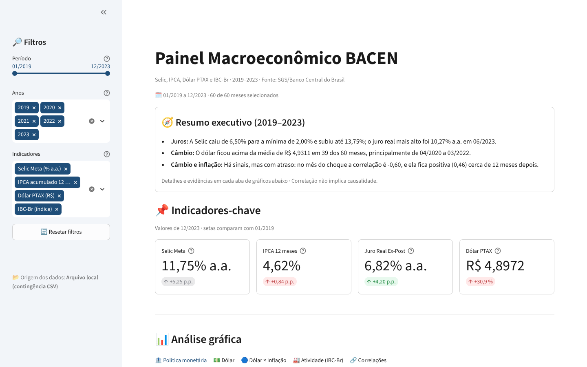
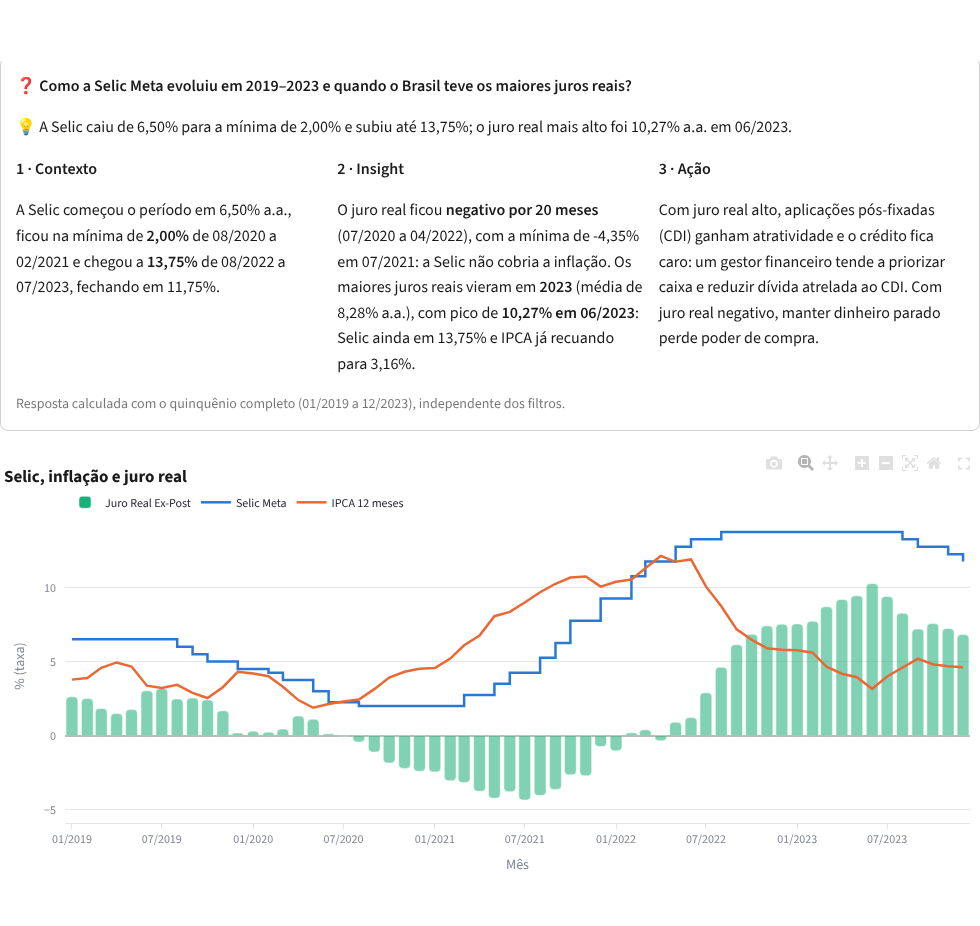
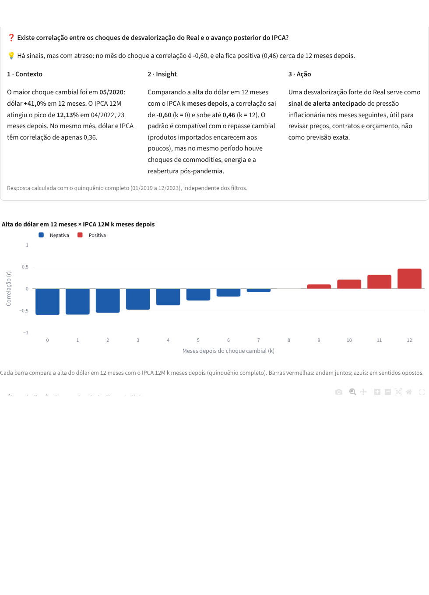
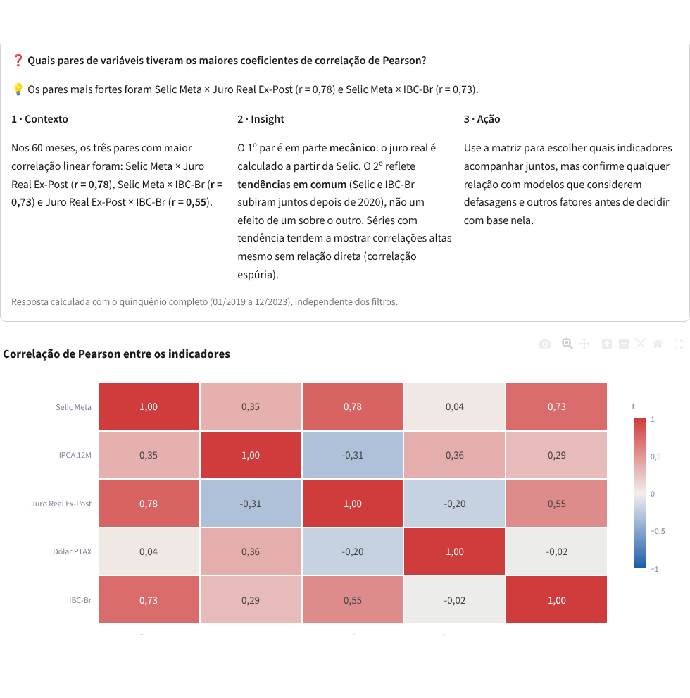
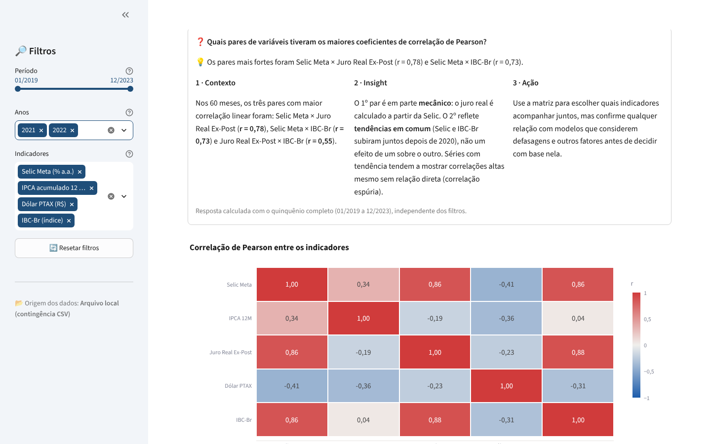
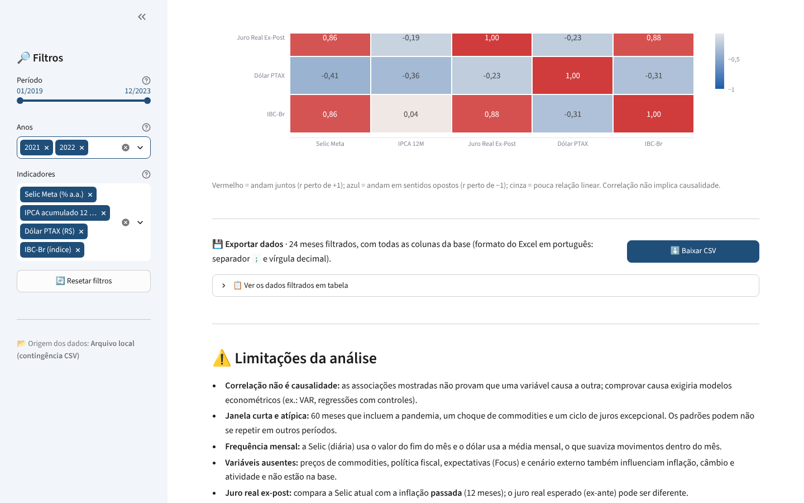
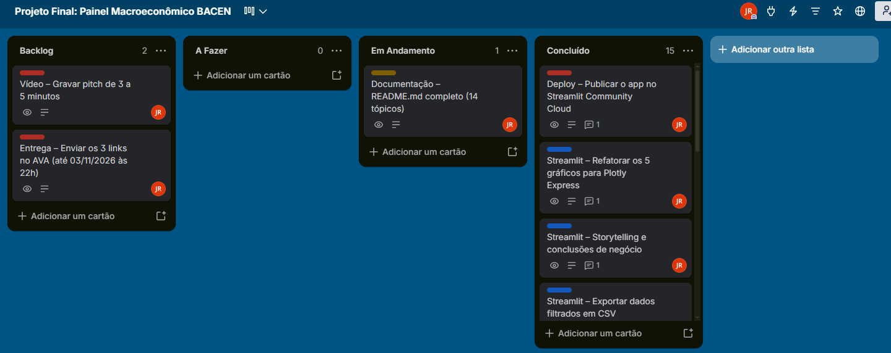

# 📈 Painel Macroeconômico BACEN

**Data App em Streamlit que transforma as séries oficiais do Banco Central em respostas de negócio sobre juros, inflação, câmbio e atividade econômica no Brasil (2019–2023).**

Projeto Avaliativo Final – Módulo 2 · Visualização de Dados e Business Intelligence [T2] · SCTEC / SENAI-SC
Linha 3 – Macroeconomia, Taxas de Juros & Indicadores Econômicos (BACEN / SGS)

| 🚀 Aplicação | 📋 Trello | 🎥 Vídeo |
|---|---|---|
| [painel-macroeconomico-bacen.streamlit.app](https://painel-macroeconomico-bacen.streamlit.app) | [Quadro Kanban do projeto](https://trello.com/b/E6jE2CtM/projeto-final-painel-macroecon%C3%B4mico-bacen) | _link adicionado após a gravação_ |



---

## Sumário

1. [Título e resumo executivo](#1-título-e-resumo-executivo)
2. [Contexto de negócio e pergunta orientadora](#2-contexto-de-negócio-e-pergunta-orientadora)
3. [Fonte de dados e licença](#3-fonte-de-dados-e-licença)
4. [Pipeline de engenharia de dados](#4-pipeline-de-engenharia-de-dados)
5. [Dicionário de dados](#5-dicionário-de-dados)
6. [Tecnologias e bibliotecas](#6-tecnologias-e-bibliotecas)
7. [Principais resultados e evidências numéricas](#7-principais-resultados-e-evidências-numéricas)
8. [Discussão e limitações da análise](#8-discussão-e-limitações-da-análise)
9. [Aplicação profissional e decisões de negócio](#9-aplicação-profissional-e-decisões-de-negócio)
10. [Demonstração do Data App](#10-demonstração-do-data-app-streamlit)
11. [Como executar localmente](#11-como-executar-localmente)
12. [Estrutura de pastas](#12-estrutura-de-pastas)
13. [Gestão ágil e links do projeto](#13-gestão-ágil-e-links-do-projeto)
14. [Autoria e créditos](#14-autoria-e-créditos)

---

## 1. Título e resumo executivo

**Painel Macroeconômico BACEN** é um Data App que reúne em uma única tela as cinco séries macroeconômicas mais acompanhadas por gestores financeiros: **Selic Meta, IPCA (mensal e 12 meses), Dólar PTAX e IBC-Br**, de janeiro de 2019 a dezembro de 2023.

O período cobre um ciclo completo e atípico: juros na mínima histórica durante a pandemia, choque de inflação, o maior ciclo de alta da Selic em décadas e o início da desinflação. O painel calcula indicadores derivados (como o **juro real ex-post**), permite filtrar o período e responde, com números calculados a partir dos dados, às **cinco perguntas de negócio** oficiais da Linha 3.

**Em uma frase:** a Selic foi de 6,50% para 2,00% e depois a 13,75%; o juro real chegou a **10,27% a.a. em 06/2023**, e a alta do dólar aparece associada à inflação **cerca de 12 meses depois**, sem que isso prove causa.

## 2. Contexto de negócio e pergunta orientadora

Juros, inflação e câmbio definem o custo do crédito, o retorno das aplicações, o preço dos produtos importados e o ritmo das vendas. Mesmo assim, essas informações costumam estar espalhadas em séries separadas, com frequências diferentes (diária e mensal) e sem interpretação.

**Pergunta orientadora:** _como Selic, inflação, câmbio e atividade econômica se comportaram juntos entre 2019 e 2023, e o que um gestor deveria observar nesses indicadores para decidir sobre crédito, caixa e preços?_

**Perguntas de negócio oficiais (Linha 3), respondidas no app:**

1. Como a Selic Meta evoluiu no ciclo 2019–2023 e em quais momentos o Brasil teve as maiores taxas de juro real ex-post frente ao IPCA 12M?
2. Qual foi a trajetória do Dólar PTAX e em quais janelas o câmbio ficou acima da média do quinquênio?
3. Existe correlação visual e estatística entre os choques de desvalorização do Real e o avanço posterior do IPCA?
4. Como o IBC-Br reagiu aos períodos de aperto monetário (alta da Selic) e aos ciclos de corte?
5. Quais pares de variáveis tiveram os maiores coeficientes de correlação de Pearson no período?

## 3. Fonte de dados e licença

- **Fonte oficial:** [Sistema Gerenciador de Séries Temporais (SGS)](https://www3.bcb.gov.br/sgspub/) do Banco Central do Brasil
- **Método de obtenção:** API pública oficial, em JSON: `https://api.bcb.gov.br/dados/serie/bcdata.sgs.{codigo}/dados`
- **Período:** 01/01/2019 a 31/12/2023 (60 meses)
- **Data da extração:** 23/10/2026
- **Licença:** dados públicos do Banco Central do Brasil, de livre utilização com citação da fonte. Não há dados pessoais (LGPD), e nenhuma credencial é necessária para acessar a API.

| Código SGS | Série | Unidade | Periodicidade original | Registros brutos |
|---|---|---|---|---|
| 432 | Taxa Selic Meta (Copom) | % a.a. | Diária | 1.826 |
| 433 | IPCA – variação mensal | % | Mensal | 60 |
| 13522 | IPCA – acumulado em 12 meses | % | Mensal | 60 |
| 1 | Dólar comercial PTAX – venda | R$ por US$ | Dias úteis | 1.255 |
| 24364 | IBC-Br dessazonalizado | índice | Mensal | 60 |

## 4. Pipeline de engenharia de dados

O ETL é reproduzível, modular e usa **somente caminhos relativos** (`pathlib`, a partir da raiz do projeto). Ele roda com um único comando:

```bash
python -m src.pipeline            # extração + limpeza + indicadores
python -m src.pipeline --sem-api  # reaproveita os arquivos de data/raw/
```

```text
API SGS (5 séries) ──► data/raw/sgs_*.csv ──► data/processed/macro_mensal.csv ──► data/processed/macro_indicadores.csv ──► app.py
     extracao.py              limpeza.py                 indicadores.py                    Streamlit
```

| Etapa | Arquivo | O que faz |
|---|---|---|
| **1. Extração** | `src/extracao.py` | Consulta a API do SGS para cada série, com até 3 tentativas e pausa entre requisições (respeita os limites da API pública). Salva os dados **sem alteração** em `data/raw/`. |
| **2. Limpeza** | `src/limpeza.py` | Lê com encoding UTF-8 explícito; converte datas `dd/mm/aaaa` para `datetime`; converte valores de texto para `float` (troca vírgula decimal por ponto); remove nulos e duplicados (nenhum foi encontrado); **padroniza tudo em frequência mensal**: Selic = valor vigente no último dia do mês, dólar = média mensal; une as 5 séries. |
| **Validação** | `src/limpeza.py` | Checagens automáticas: exatamente 60 meses, em ordem, sem nulos e sem meses duplicados. Se algo falhar, o pipeline para. |
| **3. Indicadores** | `src/indicadores.py` | Calcula juro real ex-post (equação de Fisher), média do dólar no período, variações em 12 meses, variação da Selic e classificação do ciclo monetário; contém as funções de correlação de Pearson e de correlação com defasagem. |
| **4. Carregamento no app** | `src/dados.py` | Conexão resiliente: tenta o PostgreSQL na nuvem (`st.connection`) se houver credenciais e, em qualquer falha, usa a **contingência local** em CSV. Leitura com `@st.cache_data(ttl=3600)`. |

**Fórmula do juro real ex-post (Fisher):**

```text
juro_real = ((1 + Selic/100) / (1 + IPCA_12m/100) − 1) × 100
```

## 5. Dicionário de dados

Base final: `data/processed/macro_indicadores.csv`. São 60 linhas (1 por mês) e 15 colunas. A versão completa, com faixas de valores e regras detalhadas, está em **[docs/dicionario_dados.md](docs/dicionario_dados.md)**.

| Coluna | Tipo | Significado financeiro |
|---|---|---|
| `data` | datetime | Mês de referência (1º dia do mês) |
| `ano` / `mes` | int | Ano e mês de referência |
| `selic_meta` | float | Taxa básica de juros definida pelo Copom (% a.a.), vigente no fim do mês |
| `ipca_mensal` | float | Inflação oficial do mês (%) |
| `ipca_12m` | float | Inflação acumulada em 12 meses (%) |
| `dolar_ptax` | float | Dólar comercial PTAX de venda, média do mês (R$) |
| `ibc_br` | float | Índice de atividade econômica do BC, dessazonalizado ("prévia do PIB") |
| `juro_real_ex_post` | float | Selic descontada a inflação passada de 12 meses (% a.a.) |
| `dolar_media_periodo` | float | Média do dólar nos 60 meses (R$ 4,9311) |
| `dolar_acima_media` | bool | Se o dólar do mês ficou acima da média do quinquênio |
| `dolar_var_12m` | float | Variação do dólar em 12 meses (%): mede choques cambiais |
| `ibc_br_var_12m` | float | Crescimento da atividade em 12 meses (%) |
| `selic_variacao_pp` | float | Mudança da Selic em relação ao mês anterior (pontos percentuais) |
| `ciclo_monetario` | texto | Alta, Corte ou Estável, conforme a decisão refletida no mês |

## 6. Tecnologias e bibliotecas

| Ferramenta | Uso no projeto | Por que foi escolhida |
|---|---|---|
| **Python 3.12** | Linguagem de todo o projeto | Padrão de mercado em dados; mesma versão do deploy |
| **requests** | Extração da API do SGS | Simples e confiável para APIs REST públicas |
| **pandas** | Limpeza, reamostragem mensal, indicadores e correlações | Tratamento de séries temporais (`resample`, `pct_change`, `corr`) |
| **numpy** | Base numérica do pandas | Dependência de cálculo |
| **Streamlit** | Data App: filtros, KPIs, abas, cache, estado, download | Transforma scripts Python em app web, com deploy gratuito |
| **Plotly Express** | Os 5 gráficos analíticos e o gráfico de defasagem | Gráficos interativos (zoom, tooltip) e personalizáveis |
| **SQLAlchemy + psycopg 3** | Conexão opcional com PostgreSQL (`st.connection`) | Padrão do Streamlit para bancos SQL na nuvem (ex.: Supabase) |
| **Streamlit Community Cloud** | Hospedagem do app | Deploy gratuito integrado ao GitHub |
| **Git + GitHub (GitFlow)** | Versionamento: `main`, `develop` e uma `feature/*` por tarefa | Histórico rastreável, com PR para cada entrega |
| **Trello (Kanban)** | Planejamento: Backlog → A Fazer → Em Andamento → Concluído | Gestão ágil individual, uma tarefa por vez |

Versões mínimas testadas (instalação limpa): `streamlit>=1.50`, `pandas>=2.2`, `numpy>=2.0`, `plotly>=5.24`. Detalhes em [`requirements.txt`](requirements.txt).

## 7. Principais resultados e evidências numéricas

Todos os números abaixo foram calculados pelo próprio app (`src/storytelling.py`) a partir da base de 60 meses.

### 1) Selic e juro real

- A Selic começou em **6,50% a.a.**, ficou na mínima de **2,00%** de 08/2020 a 02/2021 e chegou a **13,75%** de 08/2022 a 07/2023, fechando 2023 em 11,75%.
- O juro real ficou **negativo por 20 meses** (07/2020 a 04/2022), com mínima de **−4,35% em 07/2021**: a taxa básica não cobria a inflação.
- Os maiores juros reais vieram em **2023** (média de 8,28% a.a.), com pico de **10,27% a.a. em 06/2023**: Selic em 13,75% e IPCA 12M já em 3,16%.



### 2) Dólar acima da média

- O dólar foi de **R$ 3,7236** (02/2019) ao pico de **R$ 5,6514** (12/2021); a média do quinquênio foi **R$ 4,9311**.
- Ficou acima da média em **39 dos 60 meses**, em 3 janelas: **04/2020 a 03/2022 (24 meses)**, 05/2022 a 05/2023 (13 meses) e 09/2023 a 10/2023 (2 meses).

### 3) Choques cambiais e inflação

- O maior choque cambial foi em **05/2020**: dólar **+41,0% em 12 meses**. O IPCA 12M atingiu o pico de **12,13% em 04/2022**, 23 meses depois.
- Comparando a alta do dólar em 12 meses com o IPCA **k meses depois**, a correlação sai de **−0,60 (k = 0)** e sobe até **+0,46 (k = 12)**. O padrão é **compatível com o repasse cambial**, mas o mesmo período teve choques de commodities, energia e a reabertura pós-pandemia.



### 4) Atividade econômica × ciclo de juros

| Fase | Período | Selic | IBC-Br |
|---|---|---|---|
| Corte | 08/2019 a 08/2020 | 6,50% → 2,00% | 96,63 → 93,51 (−3,2%), vale de 82,96 em 04/2020 |
| Alta | 03/2021 a 08/2022 | 2,00% → 13,75% | 95,31 → 101,10 (**+6,1%**) |
| Selic no topo | 09/2022 a 07/2023 | 13,75% | +1,7% em 11 meses |

O resultado contraria o senso comum: a atividade **cresceu durante a alta** e caiu no corte. Isso **não** significa que juro alto acelera a economia. O Copom reage à economia e à inflação, e os efeitos dos juros chegam com **defasagem de vários meses**. Com a Selic parada no topo, o crescimento desacelerou.

### 5) Pares com maior correlação de Pearson

| Par | r | Leitura |
|---|---|---|
| Selic Meta × Juro Real Ex-Post | **0,78** | Em parte **mecânico**: o juro real é calculado a partir da Selic |
| Selic Meta × IBC-Br | **0,73** | **Tendência em comum** depois de 2020, não efeito de um sobre o outro |
| Juro Real Ex-Post × IBC-Br | **0,55** | Mesma explicação: ambos subiram na recuperação |



## 8. Discussão e limitações da análise

O que **não** é possível afirmar com estes dados:

- **Correlação não é causalidade.** Nenhuma relação mostrada prova que uma variável causa a outra. Comprovar causa exigiria modelos econométricos (ex.: VAR, regressões com variáveis de controle).
- **Janela curta e atípica.** São 60 meses que incluem pandemia, choque de commodities e um ciclo de juros excepcional; os padrões podem não se repetir.
- **Correlação espúria.** Séries com tendência (Selic e IBC-Br subindo juntas) mostram correlações altas sem relação direta.
- **Frequência mensal.** A Selic (diária) usa o valor do fim do mês e o dólar usa a média mensal, o que suaviza movimentos dentro do mês.
- **Variáveis ausentes.** Commodities, política fiscal, expectativas (Boletim Focus) e cenário externo também influenciam inflação, câmbio e atividade.
- **Juro real ex-post × ex-ante.** O indicador usa a inflação **passada**; o juro real esperado pode ser diferente.
- **Correlações com defasagem.** Usam janelas de 12 meses sobrepostas e perdem observações a cada mês de defasagem (48 pares de meses em k = 0 e só 36 em k = 12), o que torna os coeficientes menos precisos.
- **Revisões.** O IBC-Br é revisado pelo Banco Central; valores recentes podem mudar.

## 9. Aplicação profissional e decisões de negócio

| Quem usa | Pergunta prática | Como o painel ajuda |
|---|---|---|
| **Diretor financeiro (CFO)** | Vale a pena tomar crédito agora ou esperar? | O KPI e a aba de juro real mostram se o custo do dinheiro está acima ou abaixo da inflação |
| **Tesouraria** | Onde deixar o caixa? | Com juro real alto (2023), aplicações pós-fixadas ganham atratividade; com juro real negativo, o caixa parado perde poder de compra |
| **Compras / importação** | Preciso de proteção cambial? | As janelas de dólar acima da média indicam períodos de maior risco cambial para quem paga em dólar |
| **Precificação e orçamento** | A inflação vai pressionar meus custos? | Um choque cambial forte funciona como **sinal de alerta** de pressão inflacionária nos meses seguintes |
| **Planejamento comercial** | A alta dos juros vai frear minhas vendas já? | O caso do IBC-Br mostra que o efeito dos juros chega com atraso: planejar pela trajetória esperada, não pelo mês atual |

## 10. Demonstração do Data App (Streamlit)

🔗 **Acesse:** https://painel-macroeconomico-bacen.streamlit.app

> No plano gratuito, o app "dorme" depois de alguns dias sem acesso. Se aparecer o botão **"Yes, get this app back up!"**, clique nele e aguarde cerca de 1 minuto.

### Guia de navegação

1. **Barra lateral (🔎 Filtros):** escolha o **período** (slider mês a mês), os **anos** e os **indicadores**. As escolhas ficam salvas no `st.session_state`; o botão **🔄 Resetar filtros** volta tudo ao padrão.
2. **🧭 Resumo executivo:** as três mensagens principais do quinquênio (topo da Pirâmide Invertida).
3. **📌 Indicadores-chave:** 4 KPIs (`st.metric`) com o valor do último mês filtrado e setas que comparam com o primeiro mês. As cores seguem o sentido econômico: inflação e dólar subindo em vermelho, juro real subindo em verde, Selic neutra.
4. **📊 Análise gráfica (5 abas):** cada aba responde a uma pergunta de negócio, com **Contexto → Insight → Ação**, seguida dos gráficos interativos (Plotly Express):
   - 🏦 Política monetária: Selic e IPCA 12M (linhas) + Juro Real (barras)
   - 💵 Dólar: PTAX com a linha da média do período
   - 🔵 Dólar × Inflação: dispersão (cor = ano, tamanho = Selic) + correlação por defasagem
   - 🏭 Atividade (IBC-Br): linha do índice dessazonalizado
   - 🔗 Correlações: heatmap de Pearson com valores anotados
5. **💾 Exportar dados:** baixa os meses filtrados em CSV, no formato do Excel em português.
6. **⚠️ Limitações da análise:** o que os dados não permitem concluir.

| Filtros aplicados (2021–2022) | Exportação e limitações |
|---|---|
|  |  |

### Requisitos técnicos atendidos

| Requisito do enunciado | Onde está |
|---|---|
| Conexão resiliente (`st.connection` + fallback CSV com `try/except`) | `src/dados.py` |
| Credenciais em `.streamlit/secrets.toml` (no `.gitignore`) + modelo `secrets.toml.example` | `.streamlit/` |
| `@st.cache_data` com `ttl` | `src/dados.py` |
| Filtros na sidebar + `st.session_state` + botão de reset | `src/filtros.py` |
| 4 KPIs com `st.columns` + `st.metric` e deltas | `src/kpis.py` |
| 5 gráficos em Plotly Express organizados em `st.tabs` | `src/graficos.py` |
| Exportação com `st.download_button` | `src/exportacao.py` |
| Storytelling (Pirâmide Invertida) e limitações | `src/storytelling.py` |
| Deploy no Streamlit Community Cloud | link acima |

## 11. Como executar localmente

Pré-requisitos: **Python 3.12** (ou 3.10+) e **Git**.

```bash
# 1. Clonar o repositório
git clone https://github.com/profjandirreis-sys/painel-macroeconomico-bacen.git
cd painel-macroeconomico-bacen

# 2. Criar e ativar um ambiente virtual
python -m venv .venv
# Windows:
.venv\Scripts\activate
# Linux/Mac:
source .venv/bin/activate

# 3. Instalar as dependências
pip install -r requirements.txt

# 4. (Opcional) Atualizar os dados a partir da API do Banco Central
python -m src.pipeline

# 5. Rodar o app
streamlit run app.py
```

O app abre em `http://localhost:8501`.

**Banco de dados (opcional):** sem configuração nenhuma, o app usa a contingência local (`data/processed/macro_indicadores.csv`). Para usar um PostgreSQL na nuvem (ex.: Supabase):

1. Crie no banco a tabela `macro_indicadores`, com as mesmas colunas do CSV.
2. Copie `.streamlit/secrets.toml.example` para `.streamlit/secrets.toml` e preencha host, usuário e senha.
3. O arquivo `secrets.toml` **nunca** vai para o GitHub (está no `.gitignore`). No Streamlit Cloud, as credenciais ficam em **Settings → Secrets**.

Se o banco estiver fora do ar, o app mostra um aviso e continua funcionando com o CSV.

## 12. Estrutura de pastas

```text
painel-macroeconomico-bacen/
├── app.py                      # Aplicação Streamlit (monta a página)
├── requirements.txt            # Dependências para o deploy
├── .gitignore                  # Ignora venv, caches e .streamlit/secrets.toml
├── .streamlit/
│   ├── config.toml             # Tema visual do app
│   └── secrets.toml.example    # Modelo de credenciais (sem senhas reais)
├── data/
│   ├── raw/                    # Séries brutas do SGS, sem alteração (+ LEIAME.md)
│   └── processed/              # Base mensal tratada e base final com indicadores
├── docs/
│   ├── dicionario_dados.md     # Dicionário de dados completo
│   └── img/                    # Capturas de tela usadas neste README
├── notebooks/                  # Espaço para análises exploratórias
└── src/
    ├── config.py               # Caminhos relativos, período e códigos das séries
    ├── extracao.py             # ETL 1 – API do SGS → data/raw
    ├── limpeza.py              # ETL 2 – tratamento, frequência mensal e validação
    ├── indicadores.py          # ETL 3 – indicadores derivados e correlações
    ├── pipeline.py             # Executa o ETL completo
    ├── dados.py                # Conexão resiliente (PostgreSQL ou CSV) + cache
    ├── filtros.py              # Filtros da sidebar e session_state
    ├── kpis.py                 # Cartões de KPI (st.metric)
    ├── graficos.py             # Gráficos em Plotly Express e abas
    ├── storytelling.py         # Respostas às perguntas de negócio e limitações
    └── exportacao.py           # Geração do CSV filtrado
```

## 13. Gestão ágil e links do projeto

| | Link |
|---|---|
| 📋 **Quadro Kanban (Trello, público)** | https://trello.com/b/E6jE2CtM/projeto-final-painel-macroecon%C3%B4mico-bacen |
| 🚀 **Aplicação em produção** | https://painel-macroeconomico-bacen.streamlit.app |
| 🎥 **Vídeo de apresentação (pitch)** | _link adicionado após a gravação_ |
| 💻 **Repositório** | https://github.com/profjandirreis-sys/painel-macroeconomico-bacen |

**Como o projeto foi gerido:**

- **Trello (Kanban):** colunas Backlog → A Fazer → Em Andamento → Concluído; cada card tem responsável, especificação ("O que fazer"), branch e um comentário de conclusão. **Apenas um card por vez** ficou em "Em Andamento".
- **GitFlow:** `main` (versão estável de entrega), `develop` (integração) e uma branch `feature/*` por card. Os commits são pequenos e escritos no imperativo, em português; cada entrega passou por Pull Request para a `develop`, e as branches foram mantidas após o merge.



## 14. Autoria e créditos

**Jandir Reis**: estudante de Visualização de Dados e BI (SCTEC/SENAI-SC) e de Inteligência Artificial e Ciência de Dados, em transição de carreira da educação para a área de dados.

- LinkedIn: [linkedin.com/in/profjandirreis](https://www.linkedin.com/in/profjandirreis)
- GitHub: [github.com/profjandirreis-sys](https://github.com/profjandirreis-sys)

**Orientação:** Prof. Savio Ricardo Garcia · SCTEC / SENAI-SC / LAB365

**Assistência de IA:** o desenvolvimento contou com o apoio do assistente Claude (Anthropic) na programação, nos testes e na revisão. Os commits com essa colaboração estão identificados no histórico do Git (`Co-Authored-By`).

### Referências

- Banco Central do Brasil. **Sistema Gerenciador de Séries Temporais (SGS)**. https://www3.bcb.gov.br/sgspub/
- Banco Central do Brasil. **Portal de Dados Abertos**. https://dadosabertos.bcb.gov.br/
- Banco Central do Brasil. **Atas e comunicados do Copom** (Portal de Dados Abertos). https://dadosabertos.bcb.gov.br/dataset/atas-comunicados-copom
- Streamlit. **Documentação oficial**. https://docs.streamlit.io/
- Plotly. **Plotly Express in Python**. https://plotly.com/python/plotly-express/
- pandas. **Documentação oficial**. https://pandas.pydata.org/docs/
- SENAI-SC / SCTEC. **Enunciado do Projeto Avaliativo Final – Módulo 2 – Visualização de Dados e BI [T2]**, 2026.
